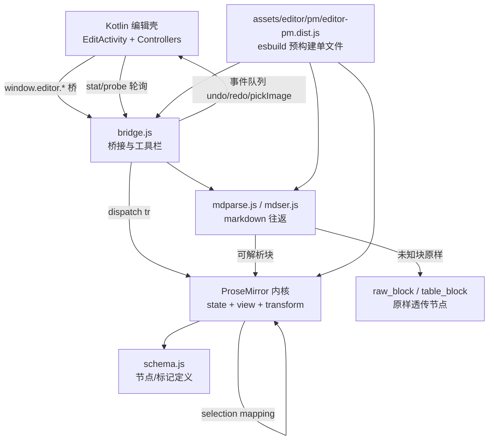

# 技术设计：ProseMirror 编辑器内核替换

Feature Name: prosemirror-editor-kernel
Updated: 2026-10-10
状态：设计稿 v1
关联：requirements.md（同目录）、ADR-005/ADR-010（被本设计取代其「事后光标恢复」路线）、真机测试清单-v1.102.md（回归基线）
目标版本：v1.103-prosemirror（versionCode 125）

## 描述

用 vanilla ProseMirror 替换 WebView 内的 Vditor IR 内核。结构变换（缩进/减缩进）与光标映射在同一个事务内原子完成，根治 v1.92→v1.102 反复出现的「重渲染后找光标」问题；Markdown 往返以「未知语法原样保留」策略保证逐字节稳定。Kotlin 桥接契约与存储层零改动。

## 架构



要点：

1. **页面文件名保持 `assets/editor/editor.html`**。Kotlin 的主题 bootstrap 注入按该文件名拦截（EditorController.kt:196），换内容不换名，Kotlin 拦截逻辑零改动。
2. **Vditor 资产保留一个版本周期**（`assets/editor/vditor/` 与旧 `editor-vditor.js` 归档不动），出问题可整页回退，v1.104 删除。
3. **光标权威从「事后恢复」变为「事务内映射」**：缩进/减缩进调用 `prosemirror-schema-list` 的 `sinkListItem`/`liftListItem`，变换以 steps 应用，选区经 `tr.mapping` 自动映射——ADR-005 的 `{blockIndex, offset}` 逻辑光标、ADR-010 的自建 hit-test 随内核退役。
4. **撤销归 PM history**：每步事务一次撤销、自动恢复选区；Kotlin `EditorHistoryController` 快照栈退役，undo/redo 改为 JS 直调 PM 命令（顶栏菜单与工具栏按钮语义不变）。

## 组件与接口

### 4.1 JS 层（assets/editor/）

| 文件 | 职责 |
|---|---|
| `editor.html` | 页面壳：主题 CSS 变量、防闪白、加载 dist；保持 Kotlin 拦截契约 |
| `pm/editor-pm.dist.js` | esbuild 打包的单文件 IIFE：PM 全家 + markdown-it + 全部胶水代码 |
| `pm/src/schema.js` | 文档 schema（见数据模型） |
| `pm/src/mdparse.js` | markdown-it 解析配置：任务列表插件、表格→`table_block`、未知块→`raw_block` |
| `pm/src/mdser.js` | 序列化器：任务列表/有序列表 start/表格原样/raw_block 原样输出 |
| `pm/src/bridge.js` | `window.editor` 实现、工具栏 DOM、JS→Kotlin 事件队列、主题注入 |
| `pm/src/toolbar.js` | 工具栏渲染与命令分发（消费 setToolbarConfig 的 JSON，视觉对齐现状） |
| `pm/src/sourcemark.js` | 源码模式（textarea 覆盖层） |

### 4.2 `window.editor` 桥接契约映射表（对 Kotlin 承诺，逐一对应现状）

| 方法 | 现状（Vditor） | 新实现（ProseMirror） |
|---|---|---|
| `loadMarkdown(src, sel, keepEditing)` | setValue | 全文替换事务：解析→`EditorState`/`replaceWith`；sel 参数映射为 PM pos |
| `getSource()` | DOM 反推规范化源码 | `mdser` 序列化 `state.doc`，未触碰部分逐字节稳定 |
| `stat()` / `probe()` | 轮询下行 | 协议不变：`{e, s, c, d, q}`，`d` 换为新内核诊断计数 |
| `indentLine()` / `outdentLine()` | 源码变换+setValue+逻辑光标还原 | LI：`sinkListItem`/`liftListItem`（事务内映射）；段落：块首插全角空格事务（行为对齐现状） |
| `undo()` / `redo()` | pushEvent → Kotlin 快照栈回放 | 直调 PM history 命令；工具栏按钮同理，Kotlin 菜单经 `editor.undo()` 调用 |
| `toggleSourceMode()` | destroy+mount | 显示/隐藏 textarea 覆盖层，进出双向零丢失 |
| `insertImage(key)` | insertValue | 插入 image 节点（`src=img://key`）事务 |
| `applyTheme(vars)` | CSS 变量+setTheme | CSS 变量注入（同一套变量名） |
| `enterEditAt` / `exitEditMode` | focus/blur | `view.focus()` / `view.dom.blur()`，editing 布尔语义不变 |
| `setToolbarConfig(cfg)` / `rebuildToolbar()` | 重建 Vditor 工具栏 | 重建自绘工具栏 DOM（工具 id 集合不变） |
| `caretToBlockStart` / `currentBlockTag` / `outdentParagraph` | v1.82 段落缩进辅助 | 按 PM 模型重实现（段落缩进链路保留） |

JS→Kotlin 事件队列：`pickImage` 保留；`undo`/`redo` 事件不再发出（PM history 接管），队列字段 `q` 协议保持。

### 4.3 Kotlin 层改动（收口到最小）

| 文件 | 改动 |
|---|---|
| `EditorHistoryController.kt` | 退役：undo/redo 转发 `editor.undo()/redo()`；`onContentChanged` 保留内容镜像职责（保存用） |
| `EditorController.kt` | `toggleRenderMode` 图标逻辑不变；`pollJsState` 不变；诊断字段名对齐新 `d` 结构 |
| `EditActivity.kt` | 历史栈装配点替换为直通调用；其余零改动 |
| 其余全部 | 零改动（存储/同步/图片/主题/列表页） |

## 数据模型（schema）

| 节点/标记 | 类型 | 属性 | Markdown 映射 |
|---|---|---|---|
| doc | 块 | - | 文档根 |
| paragraph | 块 | - | 段落 |
| heading | 块 | level 1-6 | `#` 前缀 |
| bullet_list / ordered_list | 块 | ordered: start | `-`/`*`、`1.`（start 保真） |
| list_item | 块 | checked: null/true/false | null=普通项；checked 序列化为 `- [ ]`/`- [x]`（任务列表） |
| blockquote | 块 | - | `>` |
| code_block | 块 | lang | 围栏 ```` ``` ````，lang 保真 |
| horizontal_rule | 块 | - | `---` |
| table_block | 块（atom） | raw | GFM 表格原样文本，进出逐字节不变（D2 只读决策） |
| raw_block | 块（atom） | raw | 一切不可解析块（HTML 块/脚注/数学块等）原样透传（R5.3） |
| image | 内联（atom） | src/alt/title | ``，`img://` 原样 |
| hard_break | 内联（atom） | - | 行内换行（softBreak 入口用） |
| bold/em/strike/code/link | 标记 | link: href/title | `**`/`*`/`~~`/`` ` ``/`[]()` |

任务列表渲染：`list_item` NodeView 输出原生 checkbox（`contenteditable=false`），点击切换 checked 属性（同一事务内）。

表格 NodeView：`table_block.raw` 经页面内 markdown-it 渲染为只读 HTML 表格（markdown-it 已是 prosemirror-markdown 依赖，零新增依赖）。

## 正确性性质

- **P1 往返稳定**：`loadMarkdown(src)` → 立即 `getSource()` ≡ `src`（对全部语料成立，含表格/img:///任务列表/CJK/懒延续）。未解析块落 `raw_block` 是该性质的结构保证。
- **P2 缩进光标不变式**：`indentLine/outdentLine` 事务后，光标 `pos` 经 `tr.mapping.map(oldPos, assoc)` 落在原文字符前（PM 保证）；headless e2e 以「变换前后光标所在块文本+字符偏移」断言。
- **P3 增量渲染**：每次输入只重渲染受影响节点（PM diff），无整篇 DOM 重建；大笔记（≥1000 行）无全篇闪烁。
- **P4 协议不变**：stat/probe 字段与轮询频率不变，Kotlin 侧解析代码零改动可验证。

## 错误处理

| 场景 | 处理 |
|---|---|
| 整篇解析失败（理论不可达：markdown-it 容错强） | 兜底：全文落单个 `raw_block`，保存原样还原，绝不丢数据 |
| `raw_block` 内嵌 GFM 语法歧义（如表格前缺空行） | 按最长原样块处理，P1 保证不丢；真机清单覆盖 |
| 行内未知语法（行内 HTML 等） | 按 markdown-it 默认转义为纯文本（已知边界，写入测试清单，不阻塞本版） |
| 内核脚本加载失败 | 现有 `state.ready` 门闩超时上报（沿用），页面显示可读错误文案 |
| WebView 低版本缺 ES2020 特性 | esbuild target=es2017，minSdk 26 系统 WebView（Chromium 80+）覆盖 |

## 测试策略

1. **往返单测（node，无 DOM）**：语料 = `seed_notes.json` 全部笔记 + 合成用例（嵌套有序/无序/任务混合、表格、img://、重复文本、懒延续、空项、CJK）。断言 P1。
2. **headless Chromium e2e（playwright）**：真 PM 实例驱动。
   - R2 缩进光标：v1.102 清单 I1~I4 的 10 场景 + 光标语义位断言（P2）
   - R3 点击：C1~C6 全量（posAtCoords 原生，预期直过）
   - R4 撤销：缩进→undo→结构还原且光标还原
   - 源码模式往返、任务勾选写回、主题切换
3. **Kotlin**：现有 `testDebugUnitTest` 全绿（历史栈退役相关用例同步改写）+ `assembleDebug`。
4. **真机清单 v1.103**：v1.102 全量回归 + 新内核专项（IME 中文组合输入、悬浮键盘、图片链路、深色首屏）。

## 交付与构建

1. workspace 内新增 `editor/` 构建目录：`package.json` + esbuild 配置 + 源码；`npm run build` 产出 `app/src/main/assets/editor/pm/editor-pm.dist.js`（IIFE、minify、target es2017）。
2. dist 与构建脚本一并入库：真机 ACS 侧零 npm 依赖，改内核源码需在电脑/workspace 重新出包（与现状一致：Vditor 也是入库的 dist）。
3. 版本：`versionName '1.103-prosemirror'`、`versionCode 125`；真机测试清单落库；ADR-011（内核替换决策）落库。

## 实施顺序

1. 工作区搭 `editor/` 构建链，出最小可渲染 dist（段落+标题+列表）
2. schema + mdparse/mdser + 往返单测全绿（P1 先行，保真不过关不进下一步）
3. bridge.js 全量桥接方法 + 工具栏 + 主题 + 源码模式
4. 缩进/任务勾选/撤销事务链路 + headless e2e 全绿
5. Kotlin 历史栈退役 + 装配调整 + `assembleDebug`
6. 真机清单 v1.103 + 版本收口

## 风险与边界

- **往返是生命线**：P1 语料若有漏网（用户笔记里的冷门语法），`raw_block` 兜底保证不丢数据；保存前 Kotlin 侧不再做任何规范化。
- **行内 HTML 会被转义**：现状 Vditor 保留行内 HTML；新内核首版转义。真机清单单列，若命中实际笔记再评估 inline raw 策略。
- **PM 学习成本**：schema/keymap 细节多，实施顺序上 P1 先行、e2e 后行，避免「能跑但不保真」的半成品合入。
